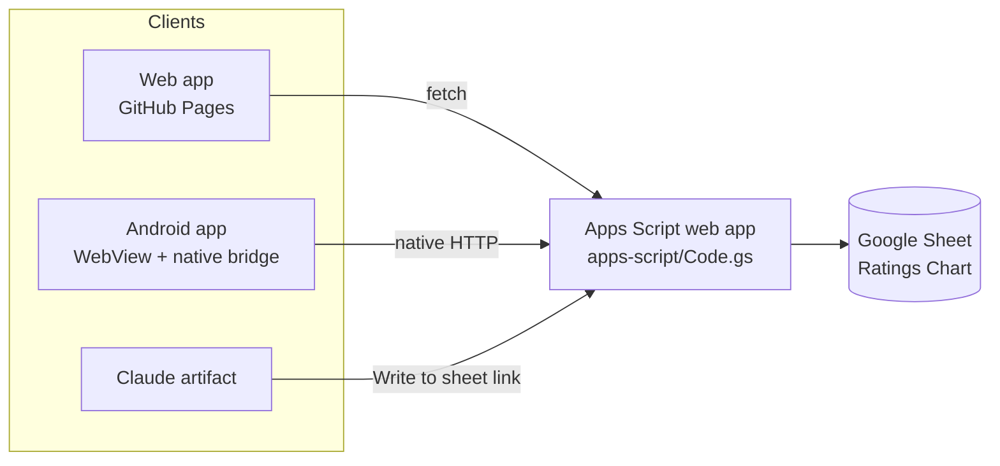

# Spin Next

**Spin Next picks your next album from the _1001 Albums You Must Hear Before You Die_ list, then logs your rating and notes to your own Google Sheet.**

Three quick questions narrow down 1,102 albums. Spin Next suggests one you haven't heard and links it on Spotify. When you've finished listening, it asks for a rating and what stood out. The Google Sheet stays the single source of truth, so your existing spreadsheet stats keep working.

It runs as an installable web app (GitHub Pages), as an Android app, and as a Claude artifact, all from one codebase.

<!-- Add screenshots here: docs/screenshots/spin.png, stats.png -->

## Features

- **Guided picks:** mood, era and listening time filter the list down to one unheard album, with a Spotify link.
- **Album profiles:** every album has a short description plus its style, instruments, region and three feel words.
- **Now spinning:** keeps the album you're on until you rate it. Albums suggested earlier stay one tap away.
- **Rating and notes:** ratings run 1–5 in half steps, plus standout tracks and free-text notes. On Android you can dictate.
- **Sheet sync:** writes the Rating, Review Date and Notes columns through a small Apps Script web app, and pulls in ratings made elsewhere.
- **Stats:** progress, average rating, rating spread against a target, ratings by month, and breakdowns by decade, genre and artist.
- **2026 edition:** the 13 albums added in 2026 are included. The 13 dropped ones are kept but flagged and excluded from picks by default.
- **Offline and installable:** a service worker and manifest let it run like an app from the home screen.

## How it works



- **One front end.** `docs/` is plain HTML, CSS and JavaScript with no framework and no build step to run it. `app.js` detects where it's running and picks the right way to reach the sheet.
- **Apps Script as a tiny API.** `doGet` returns ratings and notes; `doPost` writes a rating. A shared secret word guards both. Requests use `text/plain`, so they count as "simple" CORS requests that need no preflight.
- **Android** wraps the same files in a WebView. A small Java bridge makes HTTP requests outside the browser's CORS rules and hands off to Android's speech recogniser for voice notes.
- **Claude artifact.** Artifacts can't call other sites, so the artifact build writes ratings through a link that opens the Apps Script confirmation page.

## Project structure

```
docs/            The website (GitHub Pages serves this folder)
  index.html     Markup
  styles.css     Design tokens, light and dark themes
  app.js         All app logic
  data/albums.js Generated album catalogue and tags
  sw.js, manifest.webmanifest, icons/
data/            Source data: albums.json (from the spreadsheet), tags.json (album profiles)
apps-script/     Code.gs, the Google Sheets endpoint
android/         Android Studio project (WebView wrapper)
tools/build.py   Regenerates docs/data, bundles the Android assets, builds the single-file artifact
.github/workflows/build-apk.yml   Builds the APK on every push
```

## Setup

### 1. Google Sheet and Apps Script
1. Open your 1001 Albums spreadsheet in Google Sheets. If it's an .xlsx, use **File › Save as Google Sheets**.
2. **Extensions › Apps Script**: paste `apps-script/Code.gs` and change `TOKEN` to your own secret word. Never commit your real token.
3. Run `setup2026` once. It adds the 2026 albums, the **2026 Edition** column and the **Notes** column.
4. **Deploy › New deployment › Web app**: set *Execute as* to **Me** and *Who has access* to **Anyone**, then copy the `/exec` URL.
5. In Spin Next, open **Settings** and enter the URL and secret word. They're stored only on that device.

### 2. Website on GitHub Pages
1. In the repo, go to **Settings › Pages**, choose **Deploy from a branch**, then branch **main** and folder **/docs**.
2. The site goes live at `https://<username>.github.io/spin-next/`.
3. Custom domain: add it under **Settings › Pages**. GitHub commits a `docs/CNAME` file for you. Then point your DNS at GitHub as described in [GitHub's custom domain docs](https://docs.github.com/pages/configuring-a-custom-domain-for-your-github-pages-site) and tick **Enforce HTTPS**.
4. On Android, open the site in Chrome and choose **Add to Home screen** (or **Install app**).

### 3. Android APK (optional)
- Every push runs **Actions › Build APK**. Download the `spin-next-apk` artifact and install `app-debug.apk` on your phone.
- To build locally, run `python3 tools/build.py android`, then open `android/` in Android Studio and choose **Build › Build APK(s)**.

### Working on the code
```bash
python3 tools/build.py data       # after editing data/*.json
python3 -m http.server -d docs    # then open http://localhost:8000
python3 tools/build.py artifact   # single-file version for a Claude artifact
```

## Data notes
- The album list, years, genres, running times and track counts come from my own spreadsheet of the list.
- The album profiles in `data/tags.json` (style, instruments, region, feel, description) were drafted with an AI model from general music knowledge. They're useful for browsing but may contain mistakes.
- _1001 Albums You Must Hear Before You Die_ is a book edited by Robert Dimery. This is a personal, non-commercial project and isn't affiliated with the book or its publisher.

## Roadmap
- Move storage to Firebase (Auth + Firestore) for multiple users.
- Public profiles and a feed of what people you follow are listening to.
- Spotify album art and direct album links.

## License
Code is MIT licensed (see `LICENSE`). The album list and the data derived from it aren't covered by that license.
